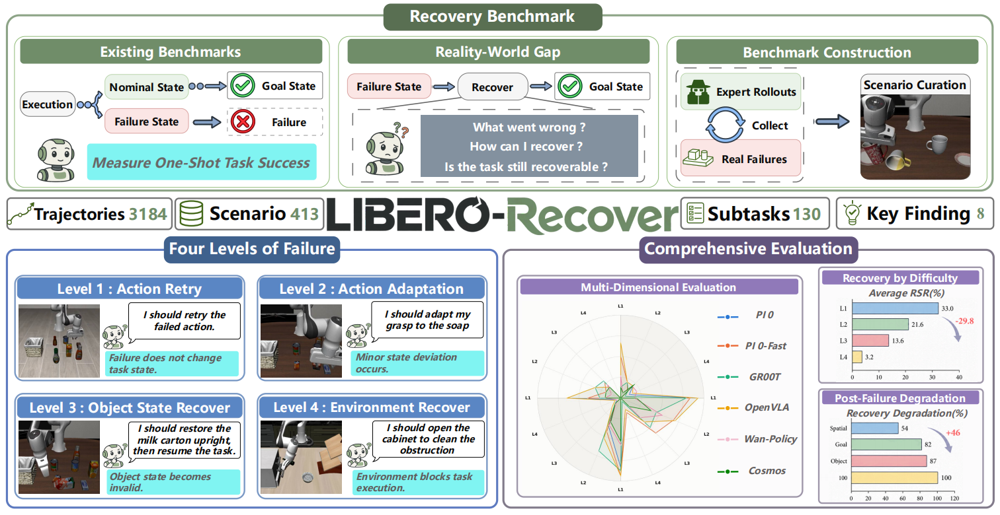

<div align="center">

# LIBERO-Recovery

**A Failure-Recovery Benchmark for Vision-Language-Action (VLA) Policies**

4,803 annotated failure scenes (recovery levels L1–L4) across the five LIBERO
suites, plus a reproducible single-script evaluation protocol.

[](https://arxiv.org/abs/2609.05178)
[](https://liulin815.github.io/LIBERO-Recovery/#)
[](https://www.modelscope.cn/datasets/ataier/LIBERO_Recovery_Expert)
[](https://www.python.org/)
[](https://pytorch.org/)

[📄 Paper](https://arxiv.org/abs/2609.05178) ·
[🌐 Project Page](https://liulin815.github.io/LIBERO-Recovery/#) ·
[🗂️ Dataset](https://www.modelscope.cn/datasets/ataier/LIBERO_Recovery_Expert) ·
[🚀 Quickstart](#quickstart)



</div>

本地 FlowDAgger × LIBERO-Recovery 离线适配：[实现说明](../FlowDAgger/docs/libero_offline_implementation.md) · [使用教程](../FlowDAgger/docs/libero_offline_usage.md)。


> **📦 Data release**: all scenes, annotations and rollouts are now available on
> ModelScope (see [§2 Data download](#2-data-download)).

LIBERO-Recovery asks not *whether* a policy can complete a task, but **how little
intervention is needed to get it back on track after a failure**. We dump failures
that actually occur during policy rollouts as replayable scenes and categorize them
by the strength of intervention required — making recovery ability a measurable,
comparable quantity.

## ✨ Highlights

| Feature | Description |
|---|---|
| 🧩 **4,803 real failure scenes** | Covering all five suites (`libero_spatial` / `object` / `goal` / `10` / `90`), dumped from real rollouts of two 4-in-1 policies |
| 📐 **Four-level recovery taxonomy** | **L1** Action Retry → **L2** Action Adaptation → **L3** Object State Recovery → **L4** Environmental Recovery, with increasing intervention cost |
| 🎯 **Reproducible protocol** | Fresh ±2 cm object perturbation on every rollout; half start gripper-closed; scene sampling, perturbations and retries are all driven by `--seed` |
| 🧰 **Ready-to-use companion data** | Expert demos (LeRobot format), pre-failure history episodes, 1,446 raw rollouts, and the full scene-construction pipeline |

## Quickstart

Four steps: **set up → download → evaluate → inspect results**.

> `$STARVLA` below = this repo's root on *your* machine (`export
> STARVLA=~/LIBERO-Recovery` after cloning). All machine-specific paths live in one
> *User-configurable parameters* block at the top of the launcher script.

```bash
# 1. envs (details: §1)
conda create -n starvla python=3.10 -y && conda activate starvla
pip install -r requirements.txt && pip install flash-attn --no-build-isolation && pip install -e .
conda create -n libero python=3.10 -y
LIBERO_DIR="$STARVLA/LIBERO" bash examples/LIBERO/eval_files/install_libero.sh

# 2. scenes (details: §2)
pip install -U modelscope
modelscope download --dataset ataier/LIBERO_Recovery_FailureScenes \
  --local_dir "$STARVLA/benchmark_failure"

# 3. evaluate (details: §3)
bash examples/LIBERO/eval_files/eval_libero_custom_scene.sh \
  --scene_dir "$STARVLA/benchmark_failure/scenes/libero_spatial"

# 4. results
cat "$STARVLA/LIBERO/eval_result/custom_scene/<model>/custom_scene/scene_summary.json"
```

---

## 1. Environment setup

Requirements: NVIDIA GPU (bf16 server + EGL off-screen rendering via
`MUJOCO_GL=egl`, set by the launcher), conda, ~1 GB disk per 300 episodes.

Two conda envs, both Python 3.10 / torch 2.6.0+cu124:

| Env | Runs | Install |
|---|---|---|
| `starvla` | policy server | `conda create -n starvla python=3.10 -y` → activate → `pip install -r requirements.txt && pip install flash-attn --no-build-isolation && pip install -e .` |
| `libero` | eval client | `conda create -n libero python=3.10 -y` → `LIBERO_DIR="$STARVLA/LIBERO" bash examples/LIBERO/eval_files/install_libero.sh` |

The LIBERO installer uses `examples/LIBERO/eval_files/requirements.txt` to
install the client dependencies, including PyYAML (`import yaml`), PyTorch,
robosuite and BDDL. Installing `LIBERO/` with `pip install -e` alone does not
install these dependencies. On first import, the installer accepts LIBERO's
default dataset path; existing `~/.libero/config.yaml` settings are preserved.

HuggingFace is forced **offline** by the launcher — base-model artifacts must
already be in `~/.cache/huggingface`.

Sanity check:

```bash
conda activate libero  && python -c "from libero.libero.envs import OffScreenRenderEnv; print('client OK')"
conda activate starvla && python -c "import flash_attn, transformers; print('server OK')"
```

## 2. Data download

```bash
pip install -U modelscope
```

| Dataset (org `ataier`) | Contents | Download to | Needed for |
|---|---|---|---|
| [`LIBERO_Recovery_FailureScenes`](https://www.modelscope.cn/datasets/ataier/LIBERO_Recovery_FailureScenes) | 4,803 scenes (bddl+npy), annotations, indices | `$STARVLA/benchmark_failure/` | ✅ running the benchmark |
| [`LIBERO_Recovery_Assets`](https://www.modelscope.cn/datasets/ataier/LIBERO_Recovery_Assets) | 880 curated scenes (launcher default) | `$STARVLA/assets/scenes/` | optional |
| [`LIBERO_Recovery_Expert`](https://www.modelscope.cn/datasets/ataier/LIBERO_Recovery_Expert) | expert demos, LeRobot format | `$STARVLA/datasets/` | training only |
| [`LIBERO_10_LL`](https://www.modelscope.cn/datasets/ataier/LIBERO_10_LL) | pre-failure history episodes | `$STARVLA/datasets/` | training only |
| [`LIBERO_Recovery_Rollouts`](https://www.modelscope.cn/datasets/ataier/LIBERO_Recovery_Rollouts) | 1,446 raw `.npz` rollouts, 80 GB | `$STARVLA/` | reproducibility only |

```bash
modelscope download --dataset ataier/LIBERO_Recovery_FailureScenes --local_dir "$STARVLA/benchmark_failure"
modelscope download --dataset ataier/LIBERO_Recovery_Assets     --local_dir "$STARVLA/assets/scenes"
modelscope download --dataset ataier/LIBERO_Recovery_Expert     --local_dir "$STARVLA/datasets/LIBERO_Recovery_Expert"
modelscope download --dataset ataier/LIBERO_10_LL               --local_dir "$STARVLA/datasets/LIBERO_10_LL"
modelscope download --dataset ataier/LIBERO_Recovery_Rollouts   --local_dir "$STARVLA"          # 80 GB
```

Layout after download:

```
$STARVLA/benchmark_failure/
├── scenes/<suite>/…            # scene pairs: <stem>.bddl + <stem>_sim_state.npy;
│                               #   L4 scenes (l4i_step_*) sit beside their source snapshot
├── annotations/
│   ├── episodes/<suite>/…      # per-episode fail-step annotations
│   └── scenes/<suite>/…        # per-scene level annotations
├── index/
│   ├── selection.jsonl         # master index, 4,803 rows (all annotation fields)
│   ├── selection_l4.jsonl      # constructed-L4 subset (465)
│   ├── injection_provenance.jsonl
│   └── scenes_index.jsonl      # full dump inventory (26,710)
└── l4i_dropped.txt             # 11 scenes excluded after t0 verification

$STARVLA/assets/scenes/         # from LIBERO_Recovery_Assets
└── selected_bddl_scenes_{spatial,goal,object,10,90}/   # 168/91/77/207/337 scenes
```

## 3. Running evaluations

### 3.1 Choose scenes

The client globs `*.bddl` **recursively** under `--scene_dir` and pairs each with
its sibling `<stem>_sim_state.npy` (missing `.npy` → scene skipped with a
warning). Any folder of such pairs works.

```bash
# one suite of the recovery library (includes its L4 scenes)
--scene_dir "$STARVLA/benchmark_failure/scenes/libero_spatial"

# curated library (launcher default)
--scene_dir "$STARVLA/assets/scenes/selected_bddl_scenes_spatial"
```

### 3.2 One recovery level only

The client reads folders, not indices — materialize a suite × level subset as a
symlink tree first:

```bash
python benchmark_failure/make_level_subset.py \
  --suite libero_90 --level L4 \
  --out "$STARVLA/benchmark_failure/subsets/libero_90_L4"
# -> 196 scenes; then
bash examples/LIBERO/eval_files/eval_libero_custom_scene.sh \
  --scene_dir "$STARVLA/benchmark_failure/subsets/libero_90_L4"
```

`--suite` / `--level` accept comma lists (`--level L1,L2`) or `any`.

### 3.3 Full command

```bash
bash examples/LIBERO/eval_files/eval_libero_custom_scene.sh [flags]
```

### 3.4 Recipes

```bash
# one model only
--algorithms our_refined_model

# two models, all scenes, single GPU
--algorithms model_a,model_b --num_scenes 0 --gpus 0

# stronger perturbation, more rollouts per scene
--obj_noise_xy 0.05 --num_close_trials 10 --num_open_trials 10

# separate log folder per experiment
--log_path "$STARVLA/LIBERO/eval_result/libero_goal_L4"

# per-model wall-clock cap in seconds (0 = unlimited)
--eval_timeout_seconds 7200
```

### 3.5 Flags

| Flag | Default | Meaning |
|---|---|---|
| `--algorithms` | `all` | `all`, or comma-separated subset of `CHECKPOINTS_PATH` keys |
| `--scene_dir` | launcher's `SCENE_DIR` | Root folder globbed recursively for `*.bddl` |
| `--gpus` | `0,1` | GPU ids; servers assigned round-robin |
| `--base_port` | `9885` | First server port; auto-bumped if occupied |
| `--seed` | `7` | Master seed — scene sampling + perturbations |
| `--retry_times` | `3` | Retries per eval job on non-zero exit |
| `--num_steps_wait` | `0` | Extra dummy steps before policy control |
| `--num_scenes` | `30` | Scenes sampled (seeded); `0` = all |
| `--num_close_trials` | `5` | Rollouts per scene, gripper starts closed |
| `--num_open_trials` | `5` | Rollouts per scene, gripper starts open |
| `--obj_noise_xy` | `0.02` | Max xy perturbation per free-joint object (m) |
| `--gripper_settle_steps` | `20` | Steps to drive gripper to initial state |
| `--server_works_per_model` | `2` | Policy servers per model |
| `--server_warmup_seconds` | `60` | Fixed wait before polling servers |
| `--server_ready_timeout_seconds` | `1800` | Give-up window for server startup |
| `--eval_timeout_seconds` | `0` | Per-job wall-clock cap via `timeout` |
| `--log_path` | launcher's `LOG_PATH` | Output root |

### 3.6 Per-scene protocol

Each scene runs `num_close_trials + num_open_trials` rollouts (default 5+5):

| Stage | What happens | Default |
|---|---|---|
| Load | Env built from `.bddl`; recorded state loaded into an **in-memory copy** (on-disk files never modified) | — |
| Perturb | Fresh uniform xy offset on every *free-joint* object (hinge/slide joints such as drawers never touched) | ±2 cm |
| Restore | Perturbed state set as init state; OSC goal re-anchored to current EEF pose | — |
| Settle | Gripper *driven* (not teleported) to target opening via zero-delta arm actions | 20 steps |
| Roll out | Policy controls robot; success = env `done` fires | ≤520 steps |
| Record | Agentview + wrist MP4s, `.npz` episode, timing metrics | always |

Notes: closed-grip starts are out-of-distribution for most LIBERO-trained
policies — success is reported per `close`/`open` split and overall; scene
sampling, perturbations and env placement retries all derive from `--seed`
(runs are reproducible); tight custom regions can fail LIBERO's placement
sampler — the client reseeds and retries ≤12×.

## 4. Configure the launcher

Edit the **User-configurable parameters** block at the top of
`examples/LIBERO/eval_files/eval_libero_custom_scene.sh`:

| Variable | Set to |
|---|---|
| `CONDA_SH` | `<your conda>/etc/profile.d/conda.sh` |
| `SERVER_ENV` / `CLIENT_ENV` | env names from §1 (default `starvla` / `libero`) |
| `STARVLA_PATH` | absolute path of repo root |
| `LIBERO_HOME` | absolute path of the LIBERO checkout |
| `SCENE_DIR` | default scene library (overridable per run via `--scene_dir`) |
| `LOG_PATH` | output root |
| `GPUS_CSV`, `BASE_PORT` | GPUs to use, first server port |
| `CHECKPOINTS_PATH` | model name → checkpoint path (§5) |

## 5. Registering models

In the launcher's associative array — key = algorithm name (output folders,
`--algorithms`), value = checkpoint path:

```bash
declare -A CHECKPOINTS_PATH=(
  #["Qwen3-VL-PI-LIBERO-4in1"]="<path>/checkpoints/steps_50000_pytorch_model.pt"
  ["our_refined_model"]="<path>/checkpoints/steps_50000_pytorch_model.pt"
)
```

Missing checkpoint file → run aborts before any server starts. Each model gets
its own server(s) and output folder.

## 6. Outputs

```
<LOG_PATH>/
├── eval_summary.txt                          # aggregated status + scores, all models
├── .tmp_eval_custom_scene_<timestamp>/       # server/eval logs, progress.tsv
└── <model>/custom_scene/
    ├── scene_summary.json                    # overall / close / open rates + per-scene
    ├── <scene_tag>/rollout_trial<i>_{close,open}_{success,failure}[_wrist].mp4
    ├── logs/
    └── dataset/raw/
        ├── manifest.jsonl                    # per-episode metadata
        └── episode_*.npz                     # images, wrist, states, actions, obj_deltas
```

Key files:

- **`scene_summary.json`** — `overall_rate`, `close_rate`, `open_rate` + per-scene
  breakdown. Example: [`docs/example_scene_summary.json`](docs/example_scene_summary.json).
- **`manifest.jsonl`** — task, scene tag, trial, `gripper_init`, success, applied
  `obj_deltas`, plus `first_contact_step` (EEF force deviates >2.0 from baseline)
  and `first_gripper_change_step` (policy gripper command flips) for recovery
  analysis. Example: [`docs/example_manifest.jsonl`](docs/example_manifest.jsonl).
- **`episode_*.npz`** — `images`, `wrist_images`, `states` (EEF pos + axis-angle +
  finger qpos), `actions` (7-DoF deltas, gripper `0=close, 1=open`),
  `task_description`, `scene`, `gripper_init`, `obj_deltas`, timing signals.
  Convert to LeRobot format: `examples/LIBERO/eval_files/convert_eval_to_lerobot.py`.

## 7. Scene data reference

**Levels** — the VLM assigns the minimum intervention needed to resume the task:

| Level | Name | Minimum intervention |
|---|---|---|
| L1 | Action Retry | re-execute the previous action (scene barely changed) |
| L2 | Action Adaptation | adapt the motion (object pose shifted, still usable) |
| L3 | Object State Recovery | restore a task object first (dropped / tipped / out of workspace) |
| L4 | Environmental Recovery | remove an **unrelated** obstructing object first |

**Statistics** (4,803 scenes = 4,338 VLM-annotated dumps + 465 constructed L4;
L4 total 474 includes 9 natural):

| Suite | L1 | L2 | L3 | L4 | total |
|---|---:|---:|---:|---:|---:|
| libero_spatial | 3 | 129 | 120 | 17 | 269 |
| libero_object | 147 | 794 | 34 | 164 | 1,139 |
| libero_goal | 11 | 354 | 148 | 49 | 562 |
| libero_10 | 11 | 473 | 194 | 48 | 726 |
| libero_90 | 120 | 871 | 920 | 196 | 2,107 |
| **total** | **292** | **2,621** | **1,416** | **474** | **4,803** |

**Provenance** — scenes were dumped from rollouts of two 4-in-1 checkpoints
(`Qwen3-VL-PI-LIBERO-4in1`, `Qwen3-VL-PI-V2-LIBERO-4in1`) at failure-relevant
steps, annotated by Qwen3-VL-27B in two passes (episode fail-steps → scene
level). Constructed L4 scenes (`l4i_step_*`) inject an obstruction onto/beside a
task object in a real snapshot, settled with the robot frozen, kept only if the
obstruction physically contacts the task object and survives a replay of the
exact eval load path (11 rejected → `l4i_dropped.txt`).

**Annotation fields** (`annotations/scenes/<suite>/<scene_id>.json`, same fields
in each `selection.jsonl` row):

```jsonc
{
  "scene_id": "libero_90__STUDY_SCENE1_…__step0340",   // l4_injected__ prefix = constructed L4
  "source": "libero_90",                // suite
  "task": "pick up the book and place it in the right compartment of the caddy",
  "npz_path": "LIBERO/eval_result/…/episode_….npz",    // rollout the scene came from
  "scene_dir": "benchmark_failure/scenes/libero_90/…/episode_…036",
  "step": 340, "stage": "post-fail",    // pre-fail / mid-fail (|step−fail|≤20) / post-fail
  "fail_steps": [80],
  "first_contact_step": 58, "first_gripper_change_step": 60,
  "level": "L3",
  "level_reason": "…", "level_confidence": 0.85, "vlm_model": "…/Qwen3VL-27B"
  // L4 scenes add an "injection" block: strategy, object pair, placement, validity
}
```

**Instruction** for a scene = the `(:language …)` line of its `.bddl`
([example](docs/example_bddl.snippet)).

## 8. Scene-data pipeline scripts

[`benchmark_failure/`](benchmark_failure/) (run in the `libero` env, EGL):

| Script | Role |
|---|---|
| `run_l4i.sh` | End-to-end L4 construction: selection → 4-GPU injection → verification |
| `l4i_inject.py` | Inject an obstruction into a real snapshot; settle; write scene + provenance |
| `l4i_eval_check.py` | Verify via exact eval load path replay (t0 obstruction check) |
| `vlm_annotate.py` | Two-pass VLM annotation (fail-steps, levels) |
| `build_index.py` | Rebuild `index/scenes_index.jsonl` |
| `make_level_subset.py` | Suite × level symlink subset (§3.2) |
| `l4i_integrate.py` / `l4i_merge.py` | Integrate constructed L4 into suite trees / indices |
| `make_release_datasets.py` | Package the ModelScope datasets |

Paths default to the authors' layout; override with `STARVLA_ROOT` / `L4I_*`
env vars (see each script's docstring).

## 9. Troubleshooting

| Symptom | Fix |
|---|---|
| `[ERROR] scene_dir does not exist` | Bad `--scene_dir`, or data not downloaded (§2) |
| `[ERROR] Checkpoint not found` | `CHECKPOINTS_PATH` entry points at missing file — fix or comment out |
| `RandomizationError` / placement failed | Normal on tight scenes; client retries ≤12×. Scene skipped only if all attempts fail — check `num_evaluated` in `scene_summary.json` |
| EGL errors (`Failed to create OpenGL context`, `GLXBadDrawable`) | Check NVIDIA EGL libs (`ldconfig -p \| grep EGL`); run on a driver with headless EGL support |
| `server ready timeout` | Read `<LOG_PATH>/.tmp_*/server_<sid>.log` (tail auto-printed). Usually GPU OOM from leftover processes — `nvidia-smi`, kill stragglers, or lower `--server_works_per_model` |
| `port_in_use` loops | Another launcher running; use a fresh `--base_port` (9883/9884 belong to sibling scripts) |
| `score=nan` / `FAIL` rows | Client exited non-zero after retries — read `<LOG_PATH>/.tmp_*/eval_<algo>_custom_scene.log` |
| HF connection attempts / slow startup | Launcher forces offline; put the base model in `~/.cache/huggingface` first |

---

*Companion scripts: `eval_libero_custom_bddl.sh` (bddl-file protocol, no gripper
split) and `eval_libero.sh` (standard LIBERO suites) — separate ports/log paths,
safe to run concurrently.*
