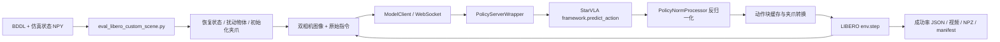

# LIBERO-Recovery：论文解读、代码结构与使用指南

整理日期：2026-10-29。本文依据论文全文及附录、官方项目页面、本地源码和实际数据文件交叉整理；论文结论、代码行为与使用建议分别说明。

- 论文：*LIBERO-RECOVER: Beyond Task Success Towards Failure Recovery in Robotic Manipulation Models*，Lin Liu 等，[arXiv:2609.05178v3](https://arxiv.org/pdf/2609.05178v3)，2026-09-28 修订，共 38 页。
- 官方仓库：[liulin815/LIBERO-Recovery](https://github.com/liulin815/LIBERO-Recovery)；[项目主页](https://liulin815.github.io/LIBERO-Recovery/)。论文使用 **LIBERO-Recover**，仓库使用 **LIBERO-Recovery**。
- 本地目录：`/home/dais/workspace/LIBERO-Recovery`；本地 `origin` 指向 `https://github.com/dddais/LIBERO-Recovery.git`，不是作者的远程地址。本文的代码结论以本地提交 `a8568c34028fb4559cd7001e6d5fb0d25df57835` 为准，不假设它与作者最新分支完全一致。
- 本次完成全文阅读、静态调用链检查、场景与标注核对，以及子集脚本和扰动纯函数的轻量验证。**没有运行模型推理、训练或 MuJoCo 仿真评测，下面的模型命令是使用指南，不是已经跑通的实验记录。**

## 1. 先理解这项工作的定位

LIBERO-Recover 是一个衡量机器人**失败后能否恢复并完成原任务**的基准，以及配套的恢复示范数据集和评测工具。其主要贡献是问题定义、失败分类、数据构建与实证分析，没有提出一个完整的新恢复策略或在线故障检测算法。

普通 LIBERO 通常从正常初始状态开始，问“最终是否成功”。这里则从实际执行中留下的异常状态重新开始，例如抓空后物体移位、杯子翻倒、其他物体挡住目标，问“策略能否根据变化后的状态修正行为，最终完成原指令”。评测时目标仍是原始任务，专家恢复动作不作为默认输入。

对使用者而言，仓库可以分成三个层次：

1. **评测已有策略**：加载 `.bddl + _sim_state.npy`，通过策略服务器执行恢复，输出成功率、视频和轨迹。
2. **训练或微调策略**：用 StarVLA 读取正常示范与 LeRobot 格式恢复示范，训练动作预测模型。
3. **构建和分析数据**：定位失败时刻、标注恢复等级、构造并验证额外的 L4 场景。

## 2. 论文主要内容

### 2.1 问题定义：失败不等于任意状态变化

任务由语言指令 `l` 与目标判定 `G(s,l)` 定义。正常执行从 `s0` 出发；恢复执行从失败状态 `sf` 出发。论文要求：

- 变化来自机器人执行过程；
- 当前尚未完成原任务，即 `G(sf,l)=0`；
- 继续原来的执行方式已不足以完成任务，需要调整或恢复；
- 仍存在某种后续策略，可以达到满足原目标的状态。

因此，“物体位置变化了”不自动等于失败；关键在于它是否破坏当前计划的可执行性，同时任务是否仍可恢复。一个场景概念上保存 `(指令、原始初态、失败轨迹、失败状态、原目标、所需恢复行为)`。[论文 §2.1–2.4，pp.3–4]

### 2.2 四级恢复分类

分类依据是**完成恢复所需的最低纠正行为与状态推理深度**，不是手动给策略指定四种控制器。

| 等级 | 名称 | 需要做什么 | 直观例子 |
|---|---|---|---|
| L1 | Action Retry，动作重试 | 任务构型基本没变，重新尝试原动作 | 抓空了，但碗仍在原位，再抓一次 |
| L2 | Action Adaptation，动作调整 | 物体发生有限变化，但仍可直接操作，调整抓点、方向或轨迹 | 物体被推偏，根据新位置重新抓取 |
| L3 | Object State Recovery，物体状态恢复 | 先恢复任务相关物体的必要状态，再执行原任务 | 将倾倒、卡住或位置不合适的目标物体恢复到可操作状态 |
| L4 | Environmental Recovery，环境恢复 | 先处理阻碍任务的其他物体或环境状态 | 移开挡住瓶子的碗，再抓瓶子 |

核心分界是 L2→L3：从“下一步动作怎么改”，转向“先创造什么中间状态，原任务才可继续”。L3 与 L4 还要区分被恢复的对象是任务直接相关物体，还是产生阻碍的环境因素。[论文 §2.3，pp.3–4]

### 2.3 论文的数据构建流程

论文描述四个阶段：[§2.4–2.5，pp.4–5；附录 B]

1. **执行原始任务并收集自然失败**：保留 LIBERO 原始指令与初始配置，让多种具身策略执行，记录完整视频与仿真状态。论文列举 π0、π0.5、OpenVLA、GR00T、Wan、Cosmos 等失败生成策略。
2. **定位失败时间**：用 Qwen3.5-27B 分析视频，识别失败前、失败发生中、失败后，定位导致偏离的交互。
3. **刻画失败与恢复需求**：结合物体、机器人、接触关系和任务进度，标注恢复等级、失败类别和恢复动作。附录描述人工复核与争议裁定。
4. **恢复数据微调后再次采样失败**：人工收集恢复示范，微调策略，再生成新的失败轨迹；论文说明用于收集恢复训练数据的场景从最终评测集排除。

论文正文报告 **2,178 个评测恢复场景**、**130 个原始子任务**。四类任务是 Spatial、Object、Goal、100；其中 LIBERO-100 包含 LIBERO-10 与 LIBERO-90，因此磁盘上对应五个 suite。

专家恢复数据由 4 位操作者使用 SpaceMouse 收集，来自 **413 个失败场景**，包含 **3,184 条恢复轨迹、625,731 帧、110 个任务类型**，20 Hz、第三人称和腕部双相机，以 LeRobot v2.1 组织。413 是采集示范的场景数，3,184 是示范轨迹数，都不等于评测场景数。[§3.1；附录 C.2，pp.22–23]

数据核验补充：上面的“110 个任务类型”是论文表述；官方发布元数据实际是 110 个 task index 对应 78 条唯一原始指令，且 3,184 条轨迹中有 373 条只有一帧。逐任务数量、训练选择及本地 `plus_featured` 的来源关系见 [数据集用途与任务数量统计](LIBERO-Recovery_数据集用途与任务数量统计.md)。

**版本边界：上述是论文 v3 的描述。本地发布数据有 4,803 个场景，并包含人工构造的 L4；不能把二者混成同一个完全一致的实验集。**详见第 3 节。

### 2.4 评测协议与指标

论文 v3 §4.1 与附录 D 的默认协议是：从失败状态加载，给自由关节物体的水平位置施加独立的 ±2 cm 均匀扰动，每场景做 5 次闭夹爪、5 次开夹爪试验，最多 **520 个策略控制步**。最终是否满足原任务目标决定成功与否。夹爪通过执行零机械臂位移的控制动作达到开/闭状态，而不是直接修改关节位置。

自然失败的**来源**与评测时对失败状态做的小幅**扰动**是两个阶段，不应将两者混为一谈。

| 指标 | 定义 | 解读 |
|---|---|---|
| RSR，Recovery Success Rate | `mean(episode_success)` | 从失败状态完成原任务的比例，可按 suite、L1–L4、夹爪条件分组 |
| RD，Recovery Degradation | `1 - (M_post + ε)/(M_pre + ε)` | 失败前后执行能力的相对损失，越低越好；需匹配任务/场景及阶段口径 |
| RC，Recovery Consistency | `1 - Std_k(R_k)` | `R_k` 是任务 k 下所有场景/试验的恢复成功率，衡量跨任务表现的一致性 |

RC 应与 RSR 一起读：一个所有任务都失败的策略也能得到 `RC=1`。高 RC 只说明差异小，不能单独证明恢复能力强。RD 也不能直接用一个恢复 episode 的“前半段成功率/后半段成功率”替代；论文需要阶段对应的评测统计。[§3.2；附录 D.5，pp.27–29]

### 2.5 实验设置与八个主要发现

评测模型为 OpenVLA-OFT、π0-FAST、GR00T-N1.5、π0、Wan2-Policy、Cosmos-Predict2-Policy。**这些名称应按论文的 StarVLA 统一实现理解**：附录 E 表 6 中多个模型采用 Qwen 系列骨干，不应直接将结果当作各家原始发布权重的成绩。

| 发现 | 论文证据与含义 |
|---|---|
| 1. 正常任务成功率不能预测恢复能力 | 图 5 中从正常初态到失败初态性能大幅下降，排名也会变化。例如 LIBERO-100 上 Wan2 相对 GR00T 的正常执行优势，并未转化为恢复优势。 |
| 2. 状态恢复比局部动作修正困难 | 表 1 总体显示 L3/L4 更难，LIBERO-100 的 L4 六种模型均为 0。应理解为总体趋势，表内并非每行都严格随等级单调下降。 |
| 3. 失败会累积并扩大分布偏移 | 图 6 中，平均恢复成功率从 Pre 到 Post：Spatial 15.0%→6.7%，Object 38.3%→5.0%，Goal 35.5%→4.0%，100 26.2%→0.3%。反复错误交互可能让场景越来越难恢复。 |
| 4. WAM 的恢复一致性更高 | 正文报告 Cosmos 的 RC=0.8837、Wan 的 RC=0.8698。作者将状态转移建模作为可能解释；这是解释性假设，且高 RC 不等于高 RSR。 |
| 5. 较短动作块有利于恢复 | 图 8 比较执行 chunk 4/8/16/32；更短 chunk 提供更频繁的视觉反馈与修正机会。 |
| 6. 恢复示范改善恢复基准，但对正常执行收益有限 | 表 2 中，GR00T 在恢复集 LIBERO-100 上 13.3%→20.6%；OFT 为 19.3%→23.6%。正常 LIBERO 的收益小或出现下降，说明从失败状态学习动作，不保证能在自身执行过程中及时识别并处理失败。 |
| 7. 时间上下文有帮助 | 表 3 中，OFT 在 Goal 上 24.6%→30.0%，100 上 19.3%→24.7%。比较当前状态与过去状态有助于识别变化。具体输入定义在正文和附录间存在差异，见下文。 |
| 8. 恢复示范覆盖更集中的关键状态区域 | 图 9 的 KDE 分析显示恢复轨迹集中于抓取、放置、物体交互附近。它是分布可视化证据，不能单独推出完整状态空间或因果机制结论。 |

### 2.6 阅读时需要保留的限制

- **仿真范围**：论文未证明真实机器人上的恢复效果；VLM 标注、有限失败生成策略和高等级样本较少都会影响结论的适用范围。[附录 H]
- **不是在线检测基准的完整实现**：从指定失败状态恢复与在一次完整执行中“检测失败→选择恢复→继续任务”是不同能力。默认代码没有这一整套在线检测与切换模块。
- **统计文字存在不一致**：正文称 OFT 平均恢复率从 20.8% 提升至 25.4%；但表 2 的四个基线值 `15.6/32.6/24.6/19.3` 简单平均为约 **23.0%**。因此本文优先引用可直接核对的分 suite 数值，不将 20.8% 当作已核实的四套平均。
- **时间上下文定义不统一**：Key Finding 7 写“任务初始帧”，附录 E.3 写“当前帧之前的 8 帧”。本地默认评测只发当前双相机图像，也没有实现开关来重现这两个 temporal 设置。复现时需明确采用哪种输入。
- **图文口径需区分**：图 6 的 RD 标注按 Spatial/Object/Goal/100 为约 55%/87%/89%/99%；正文段落的列举顺序容易把 Object 与 Goal 对错。使用图对应关系或明确记录计算口径更稳妥。

## 3. 论文与当前发布仓库的对应关系

### 3.1 不同数字分别指什么

| 来源/对象 | 数量 | 含义 |
|---|---:|---|
| 论文 v3 正文 §2.5 | 2,178 | 论文报告的恢复评测场景 |
| 论文专家恢复数据 | 413 / 3,184 | 采集场景数 / 恢复示范轨迹数 |
| 本地 `benchmark_failure/scenes` | 4,803 | 当前发布场景，与 4,803 个状态文件一一配对 |
| 当前发布数据中的自然快照 / 构造 L4 | 4,338 / 465 | 前者包含 9 个自然 L4，因此 L4 总数为 474 |
| 本地 `assets/scenes/scenes.tar.gz` | 880 | 精选场景包，顶层目录为 `scenes/`；默认启动器指向其中 Spatial 子集 |
| README 的原始 rollout 发布量 | 1,446 | 原始 `.npz` 轨迹，README 标称约 80 GB；不等于场景数 |
| README 的完整 dump 索引 | 26,710 | 中间快照清单，不等于最终评测集 |

arXiv 摘要页面仍显示“1,000+”，PDF v3 写“2,000+”并在正文给出 2,178；项目主页部分内容也与 PDF 修订不同。因此本文的论文统计以 **PDF v3** 为准，实际运行数据以本地文件与标注为准。

### 3.2 本地数据实测分布

以下由 `benchmark_failure/annotations/scenes/*/*.json` 汇总，和本地 README 表格一致：

| Suite | L1 | L2 | L3 | L4 | 总计 |
|---|---:|---:|---:|---:|---:|
| libero_spatial | 3 | 129 | 120 | 17 | 269 |
| libero_object | 147 | 794 | 34 | 164 | 1,139 |
| libero_goal | 11 | 354 | 148 | 49 | 562 |
| libero_10 | 11 | 473 | 194 | 48 | 726 |
| libero_90 | 120 | 871 | 920 | 196 | 2,107 |
| 总计 | 292 | 2,621 | 1,416 | 474 | 4,803 |

仓库两项关键差异：[场景索引脚本](../benchmark_failure/build_index.py)、[VLM 标注脚本](../benchmark_failure/vlm_annotate.py)、[L4 构造脚本](../benchmark_failure/l4i_inject.py)

1. 当前索引流程主要关联 `Qwen3-VL-PI-LIBERO-4in1` 和 `Qwen3-VL-PI-V2-LIBERO-4in1`，标注实现加载 Qwen3-VL-27B；论文描述多个失败生成模型和 Qwen3.5-27B。
2. 465 个 L4 是对真实快照增加障碍构造的，不能描述为“全部 4,803 个都是自然产生、没有注入的失败”。构造验证主要检查物理阻碍与重载后有效性，不等于逐场景证明某个策略一定可恢复。

此外，**`selection.jsonl` 不是统一带完整等级标注的表**：实际检查 4,803 行，其中前 4,338 行没有 `level`，465 条构造 L4 带该字段。做统计、分层或关联时，应使用 `annotations/scenes`，或按 `scene_id` 与其合并。README 关于“selection 每行都有所有标注字段”的描述不适用于这一份本地数据。

## 4. 代码结构与各部分作用

```text
LIBERO-Recovery/
├── benchmark_failure/             # 场景、标注、索引和构建工具
│   ├── scenes/<suite>/            # .bddl + _sim_state.npy
│   ├── annotations/{episodes,scenes}/
│   ├── index/                     # 原始快照/选择/注入来源索引
│   ├── make_level_subset.py       # 按 suite × level 建软链接子集
│   ├── vlm_annotate.py            # 两阶段 VLM 标注
│   └── l4i_*.py, run_l4i.sh       # L4 构建、审查、验证、合并
├── examples/LIBERO/
│   ├── eval_files/                # 恢复评测客户端、启动器、标准评测
│   └── train_files/               # 训练启动示例与 LIBERO 数据注册
├── deployment/model_server/       # 模型加载、反归一化、WebSocket 服务
├── starVLA/
│   ├── model/framework/           # 完整策略：VLM4A、VM4A、WM4A
│   ├── model/modules/             # VLM、动作头、视觉/世界模型组件
│   ├── dataloader/                # LeRobot、混合采样、模态变换
│   ├── training/                  # Accelerate/DeepSpeed 训练循环
│   └── config/                    # 训练及分布式配置示例
├── LIBERO/libero/libero/           # 任务、环境包装、BDDL、物理与视觉资产
├── assets/                        # 项目图片与精选场景压缩包
├── datasets/                      # 本地数据存放目录，非所有数据随代码发布
├── docs/                          # 架构图、协议图、输出示例及本文
├── tests/                         # 框架/配置/其他环境兼容性测试
└── index.html, css/, js/           # 项目展示页面
```

`examples/` 下还有 SimplerEnv、RoboCasa、CALVIN、Franka 等。这些主要是 StarVLA 继承的跨环境能力，不是 LIBERO-Recovery 额外定义的恢复任务。

### 4.1 评测主调用链



| 文件 | 主要职责 | 阅读关注点 |
|---|---|---|
| [eval_libero_custom_scene.sh](../examples/LIBERO/eval_files/eval_libero_custom_scene.sh) | 启动模型服务、分配端口/GPU、启动评测、重试与汇总 | 顶部作者路径必须改；Shell 参数采用下划线 |
| [eval_libero_custom_scene.py](../examples/LIBERO/eval_files/eval_libero_custom_scene.py) | 扫描场景、恢复状态、扰动、控制循环、输出 | `Args`、`eval_libero_custom_scene`、`perturb_object_xy`、`settle_gripper_to` |
| [model2libero_interface.py](../examples/LIBERO/eval_files/model2libero_interface.py) | 把环境观测交给服务器，缓存动作块并逐步取动作 | `ModelClient.step/reset`；图像默认缩放为 224×224 |
| [server_policy.py](../deployment/model_server/server_policy.py) | 服务端命令行入口 | `--ckpt_path`、`--port`、`--seed`、`--config_override` |
| [policy_wrapper.py](../deployment/model_server/policy_wrapper.py) | 加载权重和配置，发现动作块长度，调用策略 | `PolicyServerWrapper.predict_action` 与握手 `metadata` |
| [policy_norm_processor.py](../deployment/model_server/policy_norm_processor.py) | 按训练数据统计和模态规则恢复动作尺度 | `unnorm_key` 必须对应训练数据 |
| [env_wrapper.py](../LIBERO/libero/libero/envs/env_wrapper.py) | LIBERO 环境接口、状态恢复与观测刷新 | `OffScreenRenderEnv`、`set_init_state` |

### 4.2 一次恢复 rollout 实际执行什么

1. 递归搜索 `scene_dir/**/*.bddl`，排序并按 seed 抽样，默认只抽 **30 个**。每个文件匹配同名 `<stem>_sim_state.npy`。
2. 从 BDDL 的 `(:language ...)` 读取任务指令；用 BDDL 建环境，加载记录的仿真状态。BDDL 定义任务、物体、区域和目标，NPY 恢复机器人与物体的数值状态；二者不能互相替代。
3. 每个 trial 从状态副本出发；设计上对自由关节物体施加 XY 扰动，不直接扰动抽屉等 hinge/slide 关节。**当前数组索引实现存在偏移问题，见第 8 节，实际执行不能直接视为正确的 XY 扰动。**
4. 重设 OSC 控制器目标，执行默认 20 步零机械臂位移动作驱动夹爪开/闭。该阶段不计入后续记录的策略轨迹。
5. 渲染图像为 256×256；取第三人称和腕部图像并翻转两个空间轴，再由客户端按模型接口缩放至 224×224。
6. 默认策略输入只有 `{"image": [agentview, wrist], "lang": instruction}`。程序会计算并保存 8 维状态，但**没有把 `state` 放入这个请求**，也未默认发送初始帧或历史帧。
7. 服务器返回已反归一化的 `[B,T,D]` 动作。客户端每执行一个完整 chunk 才再次查询模型；中间逐个消费缓存动作，不是每个控制步都重新推理。
8. 前 6 维作为末端位置/旋转增量，第 7 维为夹爪。策略/数据约定 `0=close,1=open`，环境执行约定 `+1=close,-1=open`，以 0.5 阈值转换。
9. `env.step()` 返回任务完成 `done` 即成功，否则到 520 步停止。最后输出分场景、开/闭夹爪及整体成功率。

环境构造或 reset 的物体采样失败最多重试 12 次，之后跳过该场景或 trial。**跳过项没有被计作任务失败，而是没有进入分母**，所以必须检查 `num_evaluated`、`total_episodes` 和日志。

### 4.3 模型与训练模块

- [base_framework.py](../starVLA/model/framework/base_framework.py)：统一框架构建与预训练权重加载；各策略向外提供训练 `forward` 和推理 `predict_action`。
- `model/framework/VLM4A/`：QwenOFT、QwenPI、QwenGR00T、QwenFast、PI0 等视觉语言动作框架；`WM4A/` 将 Wan/Cosmos 等世界模型特征接入动作头；`VM4A/` 包含 ACT、DiffusionPolicy。
- `model/modules/`：具体骨干、MLP/DiT/flow matching 等动作头和辅助视觉模块。比如本地 [QwenOFT.py](../starVLA/model/framework/VLM4A/QwenOFT.py) 使用动作 token 特征与 **MLP/L1 回归头**；不能仅凭论文中的模型名或表 6，将它描述成原始 OpenVLA-OFT 或指定的 DiT 结构。
- [lerobot_datasets.py](../starVLA/dataloader/lerobot_datasets.py)：按注册的 mixture 创建单数据集与混合数据集；读取视频、语言、动作和可选状态。
- [registry.py](../starVLA/dataloader/gr00t_lerobot/registry.py)：自动发现 `examples/**/train_files/data_registry/`。LIBERO 的配置入口主要是 [data_config.py](../examples/LIBERO/train_files/data_registry/data_config.py)，不应只修改底层 `mixtures.py` 而忽略上层覆盖。
- [train_starvla.py](../starVLA/training/train_starvla.py)：训练循环、预训练参数加载、优化器、保存 checkpoint/配置/数据统计；[train_starvla_cotrain.py](../starVLA/training/train_starvla_cotrain.py) 增加 VLM 与 VLA 联合训练路径。

### 4.4 数据构建脚本

| 脚本 | 实际用途与限制 |
|---|---|
| [build_index.py](../benchmark_failure/build_index.py) | 扫描已有场景 dump 和 rollout manifest 建立索引；**不会凭空生成所有失败轨迹/快照**。`ROOT` 仍是作者机器硬编码路径。 |
| [vlm_annotate.py](../benchmark_failure/vlm_annotate.py) | `episodes` 先标失败步，`scenes` 再用局部帧序列标等级；默认 stride=8，场景上下文为前 48/后 16 步。 |
| 同上 `compute_stage` | 距任一 fail step 不超过 20 步标 `mid-fail`，比首个失败早 20 步以上标 `pre-fail`，其余标 `post-fail`；这是离散窗口规则，并非完整重现论文所说“直到结果稳定”的边界。 |
| [make_level_subset.py](../benchmark_failure/make_level_subset.py) | 读取独立场景标注，按 suite、level 建立 BDDL/NPY 软链接目录，给评测器使用。 |
| [l4i_select.py](../benchmark_failure/l4i_select.py) | 优先从 L1，再从 L2 选基础快照；默认目标数 620。 |
| [l4i_inject.py](../benchmark_failure/l4i_inject.py) | 移动无关物体制造阻碍，固定机器人并做物理 settle，检查物体接触，写场景和来源信息。 |
| [l4i_verify.py](../benchmark_failure/l4i_verify.py) | 对构造场景做 VLM 审查；[run_l4i.sh](../benchmark_failure/run_l4i.sh) 的最后一步是这个审查，等级保留为 L4。 |
| [l4i_eval_check.py](../benchmark_failure/l4i_eval_check.py) | 单独重放评测加载路径并检查 t0 阻碍；**不是 `run_l4i.sh run` 自动执行的最后一步**。 |
| [l4i_repair_bddl.py](../benchmark_failure/l4i_repair_bddl.py) | 修复构造场景 BDDL 表达；同时可参考 [fix_bddl_objects.py](../examples/LIBERO/eval_files/fix_bddl_objects.py) 的类型声明处理。 |
| [l4i_merge.py](../benchmark_failure/l4i_merge.py)、[l4i_integrate.py](../benchmark_failure/l4i_integrate.py) | 将构造场景标注、文件与索引合并到原始 suite 目录。 |
| [make_release_datasets.py](../benchmark_failure/make_release_datasets.py) | 整理场景和 rollout 发布包。 |

仅评测公开场景时，不需要运行 Qwen 27B 标注或重新构造 L4。

## 5. 怎么使用：先跑通一个小规模恢复评测

### 5.1 本机当前具备什么

本次检查时：

- `starvla` 与 `libero` conda 环境已存在，但这不代表依赖或 GPU 运行已验证。
- 4,803 个场景、4,803 个状态文件与 4,803 个场景标注均存在；标注指向的 **9,606 个 BDDL/NPY 路径全部存在**。
- `assets/scenes/scenes.tar.gz` 已下载，内有 880 个精选 BDDL；默认启动器指定的精选场景目录尚未解压出来。
- 仓库内未发现 `.pt` 权重。启动器默认 `our_refined_model` 指向作者机器，不是可直接使用的本地模型。
- 启动器与 `LIBERO/libero/config.yaml` 仍含 `/H20_vepfs/liulin/...`。**仅设置 `STARVLA` 环境变量不会覆盖启动器内部的硬编码路径。**

建议优先用已存在的 `benchmark_failure/scenes`，准备兼容 checkpoint 后，使用下面的双终端方式。它可以显式控制服务端 seed、数据统计 key 与 LIBERO 配置路径。

### 5.2 环境准备

所有命令从仓库根目录执行。已有环境可跳过创建步骤；不需要为阅读本文重新安装全部依赖。

```bash
export STARVLA=/home/dais/workspace/LIBERO-Recovery
cd "$STARVLA"
source /mnt/public1/dais/miniconda3/etc/profile.d/conda.sh

# 新机器或不存在环境时才创建。
conda create -n starvla python=3.10 -y
conda activate starvla

# 与仓库推荐的 CUDA 12.4 / torch 2.6 配套，需机器驱动支持。
python -m pip install torch==2.6.0 torchvision==0.21.0 \
  --index-url https://download.pytorch.org/whl/cu124
python -m pip install -r requirements.txt
python -m pip install flash-attn==2.7.4.post1 --no-build-isolation
python -m pip install -e .

conda create -n libero python=3.10 -y
LIBERO_DIR="$STARVLA/LIBERO" \
  bash examples/LIBERO/eval_files/install_libero.sh
```

服务端依赖见 [requirements.txt](../requirements.txt)；仿真端见 [eval_files/requirements.txt](../examples/LIBERO/eval_files/requirements.txt)。客户端使用 NumPy 1.24.4、MuJoCo 3.2.3、robosuite 1.4.0；服务端 NumPy 为 1.26.4，因此分环境安装有实际意义。`pip install -e .` 的包名为 `starVLA`，它本身没有声明完整运行依赖，不能代替 requirements 安装。

### 5.3 生成本机 LIBERO 路径配置

下面将配置写到独立本机目录，供双终端命令使用；它不会修改仓库自带的 `LIBERO/libero/config.yaml`。

```bash
conda activate libero
export LIBERO_CONFIG_PATH="$STARVLA/.local/libero_config"
export PYTHONPATH="$STARVLA/LIBERO:$STARVLA:${PYTHONPATH:-}"
export MUJOCO_GL=egl
export PYOPENGL_PLATFORM=egl

python - <<'PY'
import os
from pathlib import Path
import yaml

repo = Path(os.environ["STARVLA"])
root = repo / "LIBERO/libero/libero"
config_dir = Path(os.environ["LIBERO_CONFIG_PATH"])
config_dir.mkdir(parents=True, exist_ok=True)
paths = {
    "benchmark_root": str(root),
    "assets": str(root / "assets"),
    "bddl_files": str(root / "bddl_files"),
    "init_states": str(root / "init_files"),
    "datasets": str(repo / "datasets"),
}
(config_dir / "config.yaml").write_text(
    yaml.safe_dump(paths), encoding="utf-8"
)
print(paths)
PY

python -c 'from libero.libero.envs import OffScreenRenderEnv; print("LIBERO import OK")'
```

这里只验证导入；渲染与物理状态是否兼容，仍需实际跑一个场景。若使用第 5.7 节的 Shell 启动器，还需将它的 `LIBERO_CONFIG_PATH` 改为这个目录，因为它会覆盖外部变量。

### 5.4 数据准备与按等级选场景

本机失败场景已存在，无需重复下载。新机器可执行：

```bash
python -m pip install -U modelscope
modelscope download --dataset ataier/LIBERO_Recovery_FailureScenes \
  --local_dir "$STARVLA/benchmark_failure"
```

其他数据按用途选择，不必为了评测下载约 80 GB 原始 rollouts：

| ModelScope 数据集 | 用途 |
|---|---|
| [LIBERO_Recovery_FailureScenes](https://www.modelscope.cn/datasets/ataier/LIBERO_Recovery_FailureScenes) | 公开失败场景、标注、索引，评测主要输入 |
| [LIBERO_Recovery_Assets](https://www.modelscope.cn/datasets/ataier/LIBERO_Recovery_Assets) | 精选场景包，可选 |
| [LIBERO_Recovery_Expert](https://www.modelscope.cn/datasets/ataier/LIBERO_Recovery_Expert) | LeRobot 恢复示范，用于训练 |
| [LIBERO_10_LL](https://www.modelscope.cn/datasets/ataier/LIBERO_10_LL) | 失败前历史，用于时间上下文研究 |
| [LIBERO_Recovery_Rollouts](https://www.modelscope.cn/datasets/ataier/LIBERO_Recovery_Rollouts) | 原始轨迹，用于重建和分析 |

如果使用本机的精选包，其内部已经有 `scenes/` 层，应从 `assets/` 解压：

```bash
# 首次解压，目标目录还不存在时执行。
tar -xzf "$STARVLA/assets/scenes/scenes.tar.gz" -C "$STARVLA/assets"
```

不要把同目录 `scenes_full.tar.gz` 当作同一个 880 场景包：其顶层是 `assets_times/`，本次检查包含 109,170 个 BDDL 条目，属于另一份更大的快照集合。

按等级评测应先创建子集，Python 评测器本身不读 `level`：

```bash
export STARVLA_ROOT="$STARVLA"
python benchmark_failure/make_level_subset.py \
  --suite libero_90 --level L4 \
  --out "$STARVLA/benchmark_failure/subsets/libero_90_L4"
```

当前数据应选出 196 个场景。`--suite` 与 `--level` 支持逗号列表或 `any`。`STARVLA_ROOT` 必须设置，否则软链接可能指向作者不存在的路径；脚本打印“196 scenes”并不证明链接有效。

### 5.5 模型权重需要哪些文件

需要与当前框架兼容的训练产物，推荐目录保持：

```text
my_run/
├── config.yaml
├── dataset_statistics.json
└── checkpoints/
    └── steps_50000_pytorch_model.pt
```

[read_mode_config](../starVLA/model/framework/share_tools.py) 从权重路径上两级定位 `config.yaml` 和 `dataset_statistics.json`，所以只复制 `.pt` 文件通常不够。配置中引用的基础 VLM、DINO/世界模型、tokenizer 等也要准备好。

[examples/LIBERO/README.md](../examples/LIBERO/README.md) 链接了 [StarVLA LIBERO checkpoint 集合](https://huggingface.co/collections/StarVLA/bench-libero)。其中的模型可作为兼容性检查起点，但**没有依据保证任意其中权重等于论文所报 checkpoint**。应核对模型卡、训练配置、代码版本和输入模态。

若 `dataset_statistics.json` 有多个顶层 key，需要选出当前 LIBERO 动作空间对应的 key，传给客户端 `--args.unnorm-key`。单个 key 可自动选择。此归一化 key 不一定与 suite 名相同，不能随意填写 `libero_spatial`。

### 5.6 双终端最小评测

以下 `/path/to/...` 均是必须替换的资源路径。两个终端分别设置根路径与环境变量，不能依赖另一个终端导出的变量。

**终端 A：模型服务器。**

```bash
source /mnt/public1/dais/miniconda3/etc/profile.d/conda.sh
conda activate starvla
export STARVLA=/home/dais/workspace/LIBERO-Recovery
cd "$STARVLA"
export PYTHONPATH="$STARVLA:${PYTHONPATH:-}"
export CKPT=/path/to/my_run/checkpoints/steps_50000_pytorch_model.pt

CUDA_VISIBLE_DEVICES=0 python deployment/model_server/server_policy.py \
  --ckpt_path "$CKPT" \
  --port 9885 \
  --use_bf16 \
  --seed 7
```

若 checkpoint 配置里的基础模型路径属于作者机器，可以在兼容模型上追加：

```bash
# 这是追加到上面服务器命令的参数示例，不是独立命令。
--config_override framework.qwenvl.base_vlm=/path/to/local/base_vlm
```

**终端 B：先评测 1 个场景，开/闭夹爪各 1 次。**等待服务器启动并打印 metadata 后运行：

```bash
source /mnt/public1/dais/miniconda3/etc/profile.d/conda.sh
conda activate libero
export STARVLA=/home/dais/workspace/LIBERO-Recovery
cd "$STARVLA"
export LIBERO_CONFIG_PATH="$STARVLA/.local/libero_config"
export PYTHONPATH="$STARVLA/LIBERO:$STARVLA:${PYTHONPATH:-}"
export MUJOCO_GL=egl
export PYOPENGL_PLATFORM=egl
export EVAL_OUT="$STARVLA/LIBERO/eval_result/recovery_smoke_$(date +%Y%m%d_%H%M%S)"

CUDA_VISIBLE_DEVICES=0 python examples/LIBERO/eval_files/eval_libero_custom_scene.py \
  --args.host 127.0.0.1 \
  --args.port 9885 \
  --args.scene-dir "$STARVLA/benchmark_failure/scenes/libero_spatial" \
  --args.num-scenes 1 \
  --args.num-close-trials 1 \
  --args.num-open-trials 1 \
  --args.obj-noise-xy 0.02 \
  --args.gripper-settle-steps 20 \
  --args.seed 7 \
  --args.video-out-path "$EVAL_OUT" \
  --args.save-dataset True \
  --args.dataset-out-path "$EVAL_OUT/dataset"
```

多 key checkpoint 在上面追加 `--args.unnorm-key 实际统计key`。Python 参数是 Tyro 的 `--args.xxx-yyy`，与 Shell 启动器的 `--xxx_yyy` 不同。

该命令适用于输入契约匹配“当前双相机图像+指令”的模型。若 checkpoint 必须使用本体状态或历史图像，需先扩展客户端请求并核对预处理，不能只靠切换权重完成接入。

正式统计前应先处理第 8 节的扰动索引问题。若仅做接口连通性排查，可临时设 `--args.obj-noise-xy 0` 来关闭该扰动，但这属于诊断设置，不等于论文默认评测协议。

小规模成功后，把 `num-scenes` 改成 `0`，`num-close-trials/num-open-trials` 改为 `5/5`，即可评测指定目录的所有场景。只测某等级时换成第 5.4 节生成的子集目录。**评测整个 4,803 场景库、每场景 10 次，将产生 48,030 次 rollout**，应按 suite/level 拆分并规划视频与 NPZ 存储。

### 5.7 使用仓库 Shell 启动器

若希望使用自动启动、日志汇总和重试，先编辑 [eval_libero_custom_scene.sh](../examples/LIBERO/eval_files/eval_libero_custom_scene.sh) 中以下配置：

| 变量/位置 | 本机设置 |
|---|---|
| `CONDA_SH` | `/mnt/public1/dais/miniconda3/etc/profile.d/conda.sh` |
| `STARVLA_PATH` | `/home/dais/workspace/LIBERO-Recovery` |
| `LIBERO_HOME` | `/home/dais/workspace/LIBERO-Recovery/LIBERO` |
| `SCENE_DIR`、`LOG_PATH` | 真实存在的场景目录、独立实验输出目录 |
| `CHECKPOINTS_PATH` | 将自定义模型名映射到真实 checkpoint |
| `export LIBERO_CONFIG_PATH=...` | 改成 `$STARVLA_PATH/.local/libero_config`，或修正它原先读取的仓库内配置文件 |
| 服务端命令 | 若需固定模型采样随机性，增加 `--seed "$SEED"` |

修改后例如：

```bash
bash examples/LIBERO/eval_files/eval_libero_custom_scene.sh \
  --algorithms our_refined_model \
  --scene_dir "$STARVLA/benchmark_failure/scenes/libero_spatial" \
  --gpus 0 \
  --server_works_per_model 1 \
  --num_scenes 1 \
  --num_close_trials 1 \
  --num_open_trials 1 \
  --seed 7 \
  --log_path "$STARVLA/LIBERO/eval_result/recovery_launcher_smoke"
```

当前启动器需要注意：

- `--server_works_per_model` 默认 2，但每个模型的评测任务只使用 `algo_servers[0]`；增加服务数不会自动分片场景。单模型先设 1，避免闲置副本占显存。
- `--seed` 当前只传给评测客户端，未传给服务端。固定场景抽样不等于固定随机生成策略的全部随机性。
- 启动器强制 Hugging Face 离线模式，基础模型/tokenizer 必须已在可用本地路径或缓存中。
- Shell 当前没有 `--unnorm_key` 参数。多统计 key 模型可用双终端命令，或同时修改两处分支中的客户端命令。
- `--retry_times 3` 是初次执行之外再重试 3 次，最多 4 次。重试复用输出目录，需注意下一节的数据覆盖问题。

## 6. 如何读取输出和计算指标

### 6.1 产物结构

Shell 启动器的产物位于 `<LOG_PATH>/<model>/custom_scene/`；双终端方式直接位于传入的 `EVAL_OUT`。

```text
<eval output>/
├── scene_summary.json
├── <scene_tag>/
│   ├── rollout_trial0_close_success.mp4
│   └── rollout_trial0_close_success_wrist.mp4
└── dataset/raw/
    ├── manifest.jsonl
    └── episode_000000.npz
```

| 文件 | 内容与用途 |
|---|---|
| `scene_summary.json` | 实际评测场景数、rollout 数、成功数，整体/开/闭成功率，各场景统计 |
| `manifest.jsonl` | 每条轨迹的任务、scene tag、trial、夹爪初始条件、成功与否、扰动和接触/夹爪变化时间 |
| `episode_*.npz` | 图像、腕部图像、状态、动作及场景元信息；Python 直接运行时仅在 `save_dataset=True` 保存 |
| `*.mp4` | 20 fps 的双视角 rollout，适合定位恢复失败原因 |
| 启动器额外文件 | `eval_summary.txt`，`.tmp_eval_custom_scene_*/` 中的服务器、评测日志和 `progress.tsv` |

NPZ 的核心形状通常为 `images/wrist_images: [T,256,256,3]`、`states: [T,8]`、`actions: [T,7]`。8 维状态是末端位置 3 + 轴角 3 + 两个手指关节位置，**不是完整 MuJoCo 状态**。当前评测器不在 NPZ 中保存每步完整 `sim_state`，所以不能仅用这个文件精确恢复任意后续失败快照。

`first_contact_step` 是末端力相对基线变化超过阈值 2.0 的首次时刻，`first_gripper_change_step` 是策略夹爪命令首次翻转；二者不是 VLM 标注的失败时刻。`success` 以 manifest/summary 为准，NPZ 不直接保存这个字段。

### 6.2 最小结果检查

在终端 B 保留的 `EVAL_OUT` 下运行：

```bash
python - <<'PY'
import json, os
from pathlib import Path

s = json.loads((Path(os.environ["EVAL_OUT"]) / "scene_summary.json").read_text())
for key in ["num_discovered", "num_evaluated", "total_episodes",
            "total_successes", "overall_rate", "close_rate", "open_rate"]:
    print(key, s[key])
PY
```

1 个场景 × 开闭各 1 次，在没有跳过时应为 `num_evaluated=1`、`total_episodes=2`。不要只看进程退出码：没有发现 BDDL 时，代码会记录错误并直接返回，不一定产生非零退出码。

### 6.3 从代码结果到论文指标

- `overall_rate = total_successes / total_episodes`，这是当前实际有效 trial 集合上的 RSR。开/闭分组分别对应 `close_rate`、`open_rate`。
- 分等级最省事的方式是先建立等级子集再评测；或将 scene tag 映射回相对于本次 `scene_dir` 的 BDDL 路径，再关联场景标注。scene tag 不总是 `scene_id`，不能直接假设字符串相等。
- RC 可先按任务汇总各场景 `successes` 与 `episodes`，计算每任务 RSR，再对任务 RSR 求标准差。试验数量不同的时候，不应直接平均各场景百分比；标准差采用总体还是样本口径也应记录。
- RD 需要失败前/中/后匹配的场景统计，并明确 `M_pre/M_post` 的定义。**当前默认 summary 没有直接输出 RD/RC，也没有自动保存 level/stage 的关联结果。**

论文报告数字时，应记录代码 commit、权重/基础模型版本、场景清单、是否含构造 L4、seed、扰动、夹爪设置、有效/跳过数量、chunk、输入模态与指标聚合方式。`docs/example_scene_summary.json` 只是格式示例，其中 `scenes` 只列了部分样例，不能当作完整实验记录重新聚合。

重复运行请使用新的输出目录。当前程序以追加模式写 manifest，但 episode 编号每次从 0 开始，NPZ 同名文件会被覆盖；启动器自动重试也存在这个风险。

## 7. 怎么使用恢复数据训练或微调

### 7.1 正确的训练入口

现有 [run_libero_train.sh](../examples/LIBERO/train_files/run_libero_train.sh) 是一个示例，不是完整的论文复现入口：它当前选 `QwenOFT`、`libero_90`、4 卡，每卡 batch=1，且 `config_yaml` 指向未随仓库发布的 `starvla_overfit_10ep.yaml`。

实际训练链是：

```text
训练 YAML + 命令行覆盖
  → train_starvla.py
  → build_framework / 预训练参数加载
  → LIBERO data_registry 与 LeRobotMixtureDataset
  → 模态读取、动作归一化、优化更新
  → config.yaml + dataset_statistics.json + checkpoints/
```

可按以下步骤准备：

1. 下载正常 LIBERO 示范和 `LIBERO_Recovery_Expert`，核对 `data/`、`videos/`、`meta/` 结构和 `meta/modality.json`。恢复数据的真实字段应与 DataConfig 对齐，不能只重命名目录。
2. 在 `examples/LIBERO/train_files/data_registry/data_config.py` 中增加明确的 recovery mixture：列出正常数据与恢复数据目录、采样权重、robot type。当前 `libero_all` 只有 spatial/object/goal/10，并不含 libero_90；`libero_mix_mydata` 使用本地名称 `lerobot_mydata`，也不是自动指向官方恢复数据。
3. 单帧当前观测可参考 `libero_franka_custom`。`libero_franka` 的 `observation_indices=list(range(9))` 是非负时间偏移，不能仅凭“9 帧”就认定它实现了论文的“过去 8 帧+当前帧”；要结合实际数据采样逻辑核对。
4. 以待微调模型自己的完整训练配置为基础，设置数据根目录、mixture、动作长度、图像/状态输入、学习率、冻结模块和保存路径。
5. 使用 `trainer.pretrained_checkpoint` 加载已有动作策略参数；仅设置 `framework.qwenvl.base_vlm` 只指定 VLM 骨干，不能替代完整策略初始化。
6. 按原始场景/轨迹来源分开训练和评测；同一来源的不同时间快照也可能泄漏。不能因为文件名不同就认定完全独立。

### 7.2 训练命令模板

下面假定已准备好 `recovery_train.yaml`、完整 baseline checkpoint，以及注册名为 `libero_recovery_mix` 的数据混合。它是说明实际 CLI 的模板，**不是仓库已提供的原样可运行论文配置**。

```bash
conda activate starvla
cd "$STARVLA"
export WANDB_MODE=disabled
export RECOVERY_TRAIN_CONFIG=/path/to/recovery_train.yaml
export BASELINE_CKPT=/path/to/baseline/checkpoints/steps_50000_pytorch_model.pt
export RECOVERY_DATA_ROOT=/path/to/lerobot_data_root

CUDA_VISIBLE_DEVICES=0,1,2,3 accelerate launch \
  --config_file starVLA/config/deepseeds/deepspeed_zero2.yaml \
  --num_processes 4 \
  starVLA/training/train_starvla.py \
  --config_yaml "$RECOVERY_TRAIN_CONFIG" \
  --datasets.vla_data.data_root_dir "$RECOVERY_DATA_ROOT" \
  --datasets.vla_data.data_mix libero_recovery_mix \
  --datasets.vla_data.per_device_batch_size 1 \
  --datasets.vla_data.video_backend torchvision_av \
  --trainer.pretrained_checkpoint "$BASELINE_CKPT" \
  --trainer.gradient_accumulation_steps 4 \
  --trainer.max_train_steps 50000 \
  --trainer.num_warmup_steps 3000 \
  --trainer.save_interval 10000 \
  --run_root_dir "$STARVLA/results_custom/Checkpoints" \
  --run_id recovery_mix
```

论文附录 E.3 的 Combined 设置包括 4×H20 96 GB、ZeRO-2、有效 batch=16、50K 步、仅冻结视觉编码器、BF16。本文不保证上述模板自动重现这些所有细节：冻结模块名、优化器、scheduler、图像和状态契约、DeepSpeed 的梯度累积设置仍需在具体 YAML 中一致配置。`train_starvla.py` 与 `train_starvla_cotrain.py` 的训练目标也不能混淆。

训练完成后，将新运行目录中的 checkpoint、配置和统计一起交给第 5 节的服务器；分别评测正常 LIBERO 与恢复基准，才能观察论文所讨论的恢复收益及正常执行迁移问题。

## 8. 常见问题与复现边界

| 问题 | 原因与处理 |
|---|---|
| 刚启动就找不到 conda 脚本 | 启动器在解析参数前就 `source` 作者的 `CONDA_SH`，所以仅传 `--help` 也可能失败；先改路径或使用双终端方式。 |
| 场景目录存在但没有评测结果 | 检查是否只有压缩包、是否真的存在 `.bddl`、是否配对状态文件齐全；并检查 summary 是否生成。 |
| LIBERO asset/mesh/BDDL 找不到 | 检查实际 `LIBERO_CONFIG_PATH/config.yaml`，不只检查 `LIBERO_HOME`；随仓库配置仍是作者绝对路径。 |
| 有权重仍提示缺配置/统计 | 保留 `run/config.yaml`、`run/dataset_statistics.json`、`run/checkpoints/*.pt` 的层级。 |
| 多数据集模型反归一化报错 | 查看服务端 `available_unnorm_keys`，给客户端传正确 key。 |
| 推理成功但行为明显异常 | 核对图像顺序/翻转、尺度、是否需要 state、夹爪符号、动作尺度、模型代码版本，而不只是检查网络连接。 |
| 显存不足但只评测一个模型 | 默认两份服务器可能占用双倍模型显存；先设置 `--server_works_per_model 1`。 |
| RandomizationError | 小区域放置采样失败；代码有重试，最终仍跳过时要报告有效样本数。 |
| EGL/离屏渲染失败 | 核对 NVIDIA 驱动、EGL 库和 `MUJOCO_GL=egl`；导入成功不代表渲染成功。 |
| 固定 seed 结果仍不同 | 原始启动器没把 seed 传给服务器；还应核对随机策略、代码/依赖版本、跳过样本与硬件差异。 |
| 找不到 README 提到的辅助脚本 | 本地缺少 `eval_libero_custom_bddl.sh`、`eval_libero.sh`、`convert_eval_to_lerobot.py`；标准评测有 `eval_libero.py`，不要继续引用不存在的命令。 |
| 想做动作 chunk 消融 | 当前 `ModelClient` 把执行长度与服务端 `action_chunk_size` 绑定；需要单独控制执行步数 K≤预测长度，不能简单修改预测 horizon 后就声称复现论文“仅改变执行长度”的消融。 |

还有三个值得在正式复现实验前检查的实现细节：

1. **物体 XY 扰动的扁平状态索引偏移，已用纯函数复现。** `build_object_xy_qpos_adrs()` 返回的是 `qpos` 内的索引，但 `perturb_object_xy()` 直接用它索引整个 flattened state。本机 robosuite 1.4.0 的 `MjSimState.flatten()` 布局是 `[time, qpos..., qvel...]`，即 `qpos` 从 flattened 的第 1 个索引开始。当前写法 `s[ax] += dx; s[ay] += dy` 少了时间字段的偏移，不能保证扰动落在目标物体的 X/Y 上。例如目标 X/Y 是 `qpos[2],qpos[3]` 时，正确 flattened 索引应为 `[3,4]`，当前函数实际修改 `[2,3]`。修复方向是显式处理这个偏移，或先按 `MjSimState` 解包再修改 qpos；正式实验还需验证所有场景格式。本次只验证并记录，没有修改实现或运行物理仿真。
2. `settle_gripper_to()` 丢弃 `env.step()` 返回的观测，主循环的 `obs` 初值来自 settle 之前。默认 `num_steps_wait=0` 时第一次策略请求可能看到夹爪初始化之前的图像。本文记录这一静态代码发现，未做渲染验证。
3. L4 重载检查把 **t0 阻碍存在**作为硬条件，而 settle 20 步后是否仍有阻碍是软报告；因此“构造时有效 L4”不意味着所有扰动/夹爪初始化之后仍保持相同困难程度。

这些限制说明：当前仓库提供了可用的恢复评测基础设施，但“运行默认脚本得到一个成功率”和“严格复现论文全部表格”之间，还需要明确的场景选择、权重、模态、指标与配置对齐。

## 9. 推荐阅读顺序与来源索引

若主要想接入自己的策略，建议按以下顺序阅读：

1. 本文第 2 节理解任务与 L1–L4；再看 [README](../README.md) 和 [BDDL 示例](example_bddl.snippet)。
2. [eval_libero_custom_scene.py](../examples/LIBERO/eval_files/eval_libero_custom_scene.py)：理解输入场景、控制循环和成功判定。
3. [model2libero_interface.py](../examples/LIBERO/eval_files/model2libero_interface.py) → [policy_wrapper.py](../deployment/model_server/policy_wrapper.py) → [policy_norm_processor.py](../deployment/model_server/policy_norm_processor.py)：理解模型接口、chunk 与动作空间。
4. [data_config.py](../examples/LIBERO/train_files/data_registry/data_config.py) → [lerobot_datasets.py](../starVLA/dataloader/lerobot_datasets.py) → [train_starvla.py](../starVLA/training/train_starvla.py)：理解恢复数据如何进入训练。
5. 需要扩展基准时，再读 [vlm_annotate.py](../benchmark_failure/vlm_annotate.py)、[l4i_inject.py](../benchmark_failure/l4i_inject.py) 和 [l4i_eval_check.py](../benchmark_failure/l4i_eval_check.py)。

| 依据 | 本文使用范围 |
|---|---|
| [论文 PDF v3](https://arxiv.org/pdf/2609.05178v3)、[HTML v3](https://arxiv.org/html/2609.05178v3) | 问题定义 §2、数据/指标 §3、实验 §4，附录 B–H 的标注、协议、实现与限制 |
| [官方项目主页](https://liulin815.github.io/LIBERO-Recovery/) | 核实项目/代码/数据关联；遇到与 PDF 不一致处不混用数值 |
| [官方仓库](https://github.com/liulin815/LIBERO-Recovery) | 确认作者公开仓库身份与发布说明 |
| 本地源码提交 `a8568c3` | 调用链、参数、动作/观测接口与缺失脚本判断 |
| 本地 `annotations/scenes`、`selection.jsonl` 与场景文件 | 4,803 场景分布、字段缺失与路径完整性检查 |
| [输出格式示例](example_manifest.jsonl)、[汇总示例](example_scene_summary.json) | 展示输出字段，不作为本次执行结果 |

文档校验包括：所有本地 Markdown 文件链接存在、11 个 Bash 代码块通过语法检查、2 个内嵌 Python 代码块通过解析；在临时目录实际运行等级筛选脚本，得到 196 个 `libero_90/L4` 场景且 392 个软链接全部有效，随后清理临时目录；另以独立数组验证了上文的扰动索引偏移。

本次只新增本文，没有改动训练、评测源码或原有实验计划；没有下载大规模训练数据、安装环境或启动 GPU 实验。
